# MANUAL DE USUARIO
## SIGE-CEPA — Sistema de Gestión del Centro de Psicología Aplicada

| | |
|---|---|
| Versión del documento | 1.0 (borrador) |
| Fecha | Noviembre 2026 |
| Versión del sistema | `main` 878eed8 |
| Destinatarios | Equipo del CEPA: Coordinación, Administrativo, Auditor |

---

## 1. Introducción

SIGE-CEPA es el sistema con que el Centro de Psicología Aplicada de la Universidad de Talca gestiona a sus pacientes:

- ingresos y folios;
- licencias médicas;
- fármacos;
- controles médicos;
- Evaluaciones de Puesto de Trabajo (EPT);
- reintegro laboral;
- alertas de plazos;
- reportes.

El sistema trabaja junto a **SALUTEM**, la agenda y ficha clínica del CEPA. SIGE **lee** de SALUTEM las personas, citas y atenciones, y las cruza con sus propios registros. **Nunca modifica nada en SALUTEM**: las horas se siguen agendando allá.

Este manual explica cómo usar cada pantalla. Dentro del sistema, el ícono **(?)** de la barra superior abre la guía de la pantalla en la que estás. En el menú, **Ayuda y soporte** reúne todas las guías, las preguntas frecuentes y el glosario.

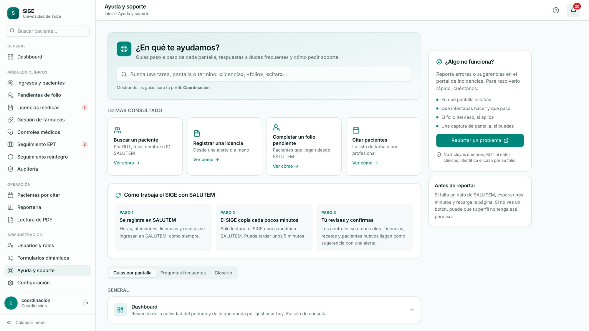

### 1.1 Perfiles de usuario

Cada cuenta tiene un perfil, y el perfil decide qué puede ver y modificar.

| Perfil | Qué puede hacer |
|---|---|
| Coordinación | Ver y registrar en todos los módulos clínicos. Administra usuarios, formularios y umbrales de alerta. Reabre casos cerrados. En Seguimiento EPT solo consulta. |
| Administrativo | Ver y registrar en los módulos clínicos. Es el único perfil que registra en Seguimiento EPT y que corrige folios. Entra a Auditoría solo si tiene el permiso «Acceso a Auditoría». |
| Auditor | Solo consulta. Tiene acceso al módulo Auditoría. |
| Superadmin | Tiene todos los permisos de los demás perfiles. |

Si no ves un botón que otra persona sí ve, es por el perfil de tu cuenta. Para cambiarlo, pídelo a Coordinación.

---

## 2. Ingreso al sistema

### 2.1 Iniciar sesión

1. Abre el sistema en el navegador: **[PENDIENTE: dirección de producción]**.
2. Ingresa tu **Usuario** y **Contraseña** y presiona **«Ingresar»**.
3. Cuando el acceso institucional esté habilitado, también podrás usar **«Ingresar con tu cuenta UTalca»**.

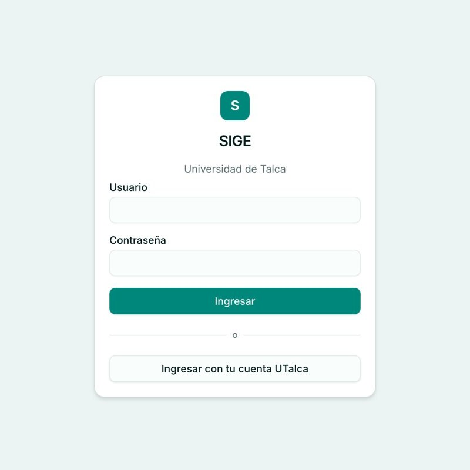

> Después de 5 intentos fallidos, la cuenta se bloquea durante 15 minutos. Si olvidaste tu contraseña, pide a Coordinación que la restablezca.

### 2.2 La pantalla principal

- **Menú lateral:** da acceso a los módulos, agrupados en «General», «Módulos clínicos», «Operación», «Configuración» y «Administración». Arriba tiene el buscador **«Buscar paciente…»**. Los **números rojos** junto a cada módulo indican pendientes: alertas sin resolver o pacientes esperando folio.
- **Campana del encabezado:** muestra las alertas sin leer. Al hacer clic en una alerta se abre el paciente o el módulo que corresponde.
- **Ícono (?):** abre la guía de la pantalla actual.
- **Cerrar sesión:** está al pie del menú lateral.

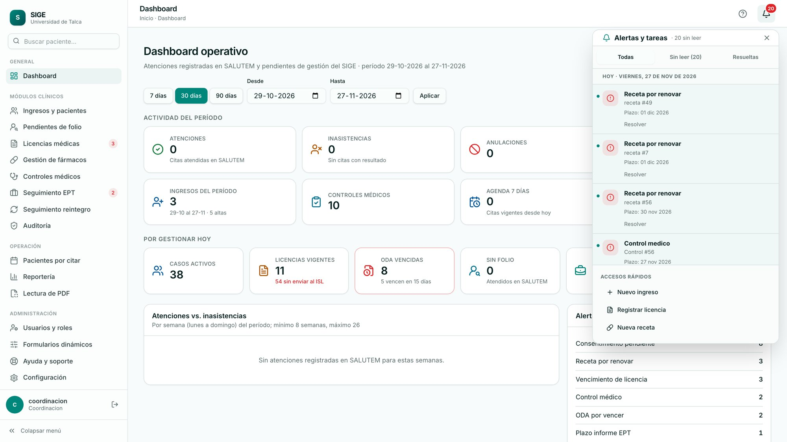

> El buscador del menú se oculta cuando el menú está colapsado. Para verlo, expande el menú.

---

## 3. Dashboard

Resume la actividad del período y lo que queda por gestionar hoy. Es solo de consulta.

**Revisar lo pendiente del día**
1. Elige el período con «7 días», «30 días» o «90 días», o escribe «Desde» y «Hasta» y presiona «Aplicar».
2. Mira la sección **«Por gestionar hoy»**: las tarjetas con borde rojo tienen algo que atender.
3. Haz clic en una tarjeta, por ejemplo «Sin folio» u «ODA vencidas», para ir directo al módulo.

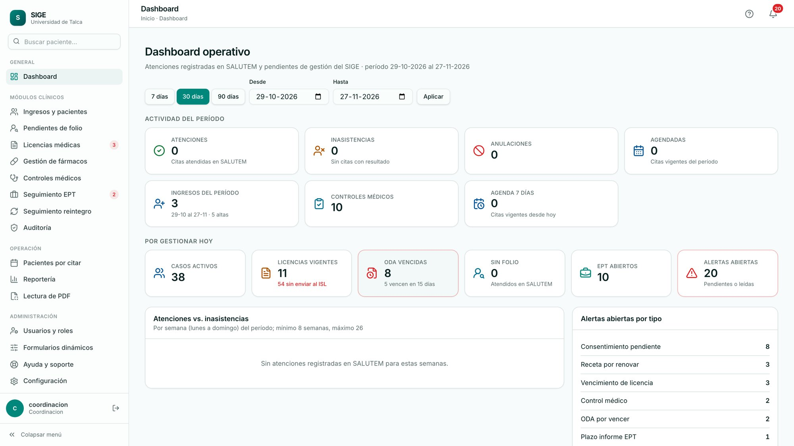

Las atenciones, inasistencias, anulaciones y horas agendadas se calculan con la copia de SALUTEM, que se actualiza sola. Si una cifra aparece como «—», todavía está cargando o no se pudo leer; no significa cero.

---

## 4. Ingresos y pacientes

Aquí se buscan pacientes, se abre su ficha completa y se crean ingresos nuevos.

**Buscar un paciente**
1. Escribe en el buscador del menú («Buscar paciente…») y presiona Enter, o usa el buscador de esta pantalla.
2. Puedes buscar por RUT (con o sin puntos), folio, parte del nombre o ID SALUTEM.
3. Haz clic en una fila para abrir la ficha. Tiene las pestañas «Resumen», «Licencias», «Fármacos», «Controles», «ODA» y «SALUTEM».

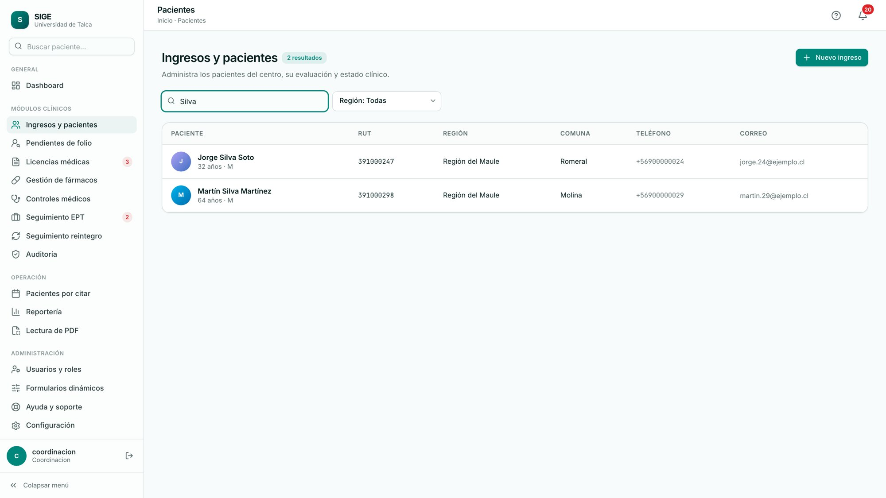

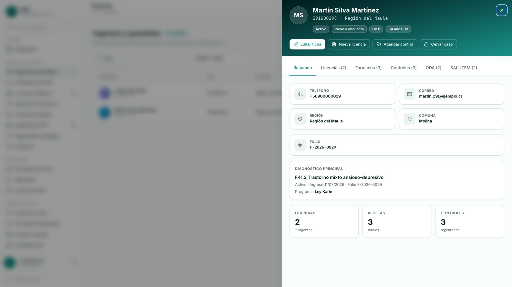

**Crear un ingreso**
1. Presiona **«Nuevo ingreso»**.
2. Completa los campos marcados con *: RUT, nombre, edad, región, fecha de ingreso, sexo, tipo de derivación y tipo de ingreso. El diagnóstico y el modelo de tratamiento pueden quedar para después.
3. Presiona **«Crear ingreso»**. El folio se asigna solo, con el formato F-2026-0001, y el ingreso queda activo.

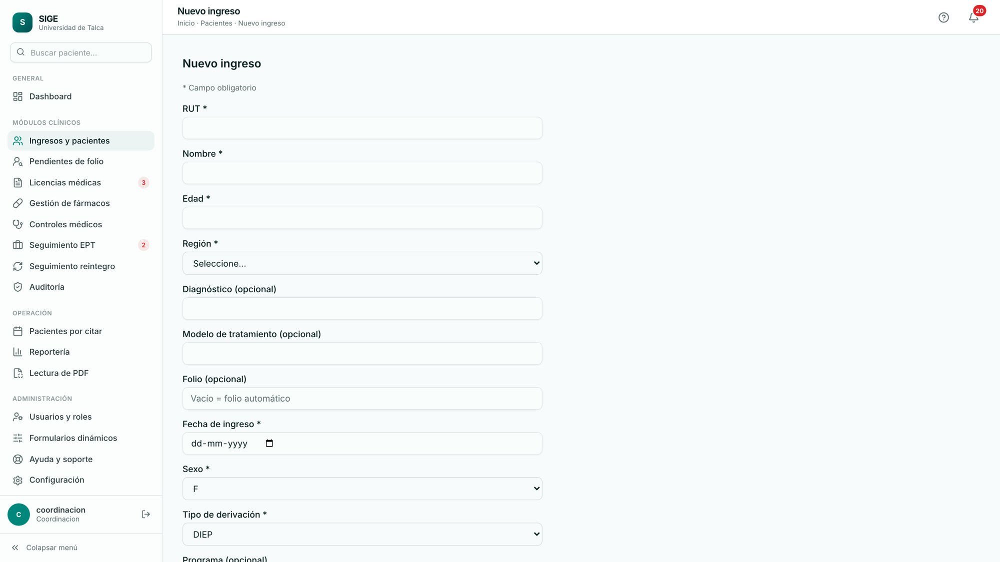

**Cerrar o reabrir un caso**
1. Abre la ficha del paciente y presiona **«Cerrar caso»**. Está junto a «Editar ficha», «Nueva licencia» y «Agendar control».
2. Elige el motivo y presiona **«Confirmar cierre»**.
3. Si el caso está cerrado, Coordinación ve en el mismo lugar el botón **«Reabrir caso»**.

**Encuadre:** desde la segunda inasistencia llega la alerta «Posible encuadre». El ingreso se pasa a encuadre, y se vuelve a activo, con el botón de la ficha del paciente.

| Etiqueta | Significado |
|---|---|
| Falta folio | Paciente creado, agendado o atendido en SALUTEM que aún no tiene ingreso en SIGE. Se resuelve con «Completar registro». |
| SALUTEM | Dato creado automáticamente desde una atención en SALUTEM. |

> Solo el perfil Administrativo puede corregir un folio, con el botón «Editar» de la tarjeta Folio. El cambio también se aplica a los reingresos.

---

## 5. Pendientes de folio

Aquí aparecen las personas creadas, agendadas o atendidas en SALUTEM que todavía no tienen ingreso en SIGE. El número rojo del menú indica cuántas quedan. La sincronización crea cada fila sola, junto con la alerta «Paciente nuevo pendiente de folio».

**Completar el registro de un paciente**
1. Presiona **«Completar registro»** en la fila del paciente.
2. Revisa los datos precargados y completa los que faltan.
3. Presiona **«Crear ingreso»**. El paciente sale de la lista y su alerta se cierra sola.

**Descartar a alguien que no es paciente del CEPA**
1. Presiona **«Descartar»**.
2. Escribe el motivo. Es obligatorio y queda registrado.
3. Confirma con **«Descartar paciente»**.

---

## 6. Licencias médicas

Aquí está el historial de licencias de cada paciente. También se registran licencias nuevas, se anulan y se marca su envío al ISL.

**Registrar una licencia**
1. Busca al paciente por RUT, folio, nombre o ID SALUTEM y selecciónalo.
2. Presiona **«Nueva licencia»**.
3. Completa el tipo de licencia, el tipo de reposo, las fechas, la cantidad de días y el diagnóstico.
4. Presiona **«Registrar licencia»**.

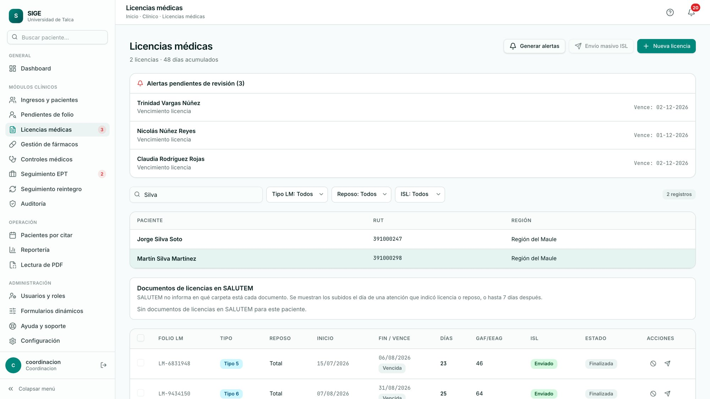

**Marcar licencias como enviadas al ISL**
1. Marca la casilla de cada licencia enviada.
2. Presiona **«Envío masivo ISL»**. Las licencias quedan como «Enviado», con la fecha de hoy.
3. Para una sola licencia, o para registrar un rechazo, usa el ícono **«Actualizar envío ISL»** de su fila.

Cuando un médico indica una licencia en SALUTEM, llega la alerta **«Licencia emitida en control»** con los datos sugeridos. La licencia **no se registra sola**: revísala y presiona «Registrar licencia».

| Etiqueta | Significado |
|---|---|
| Vigente | La licencia está en curso. |
| Vence en 2d | Quedan menos de 3 días (en rojo). |
| Vence en 5d | Quedan menos de 7 días (en amarillo). |
| Finalizada | Ya pasó la fecha de término. |
| Anulada | Se anuló con un motivo. No se puede deshacer. |
| Pendiente | Aún no se envía al ISL. |

> Anular es irreversible y pide una justificación. Si solo hay un error de fechas, corrige la licencia en vez de anularla.

---

## 7. Gestión de fármacos

Aquí está el registro farmacológico de cada paciente: esquema de indicaciones, recetas y seguimiento del tratamiento.

**Registrar una receta**
1. Busca al paciente y selecciónalo.
2. Si aparece «Sin registro farmacológico», presiona **«Crear registro»** e indica el médico tratante.
3. Presiona **«Nueva receta»** y completa el medicamento y las fechas de emisión y revisión.
4. Presiona **«Guardar receta»**.

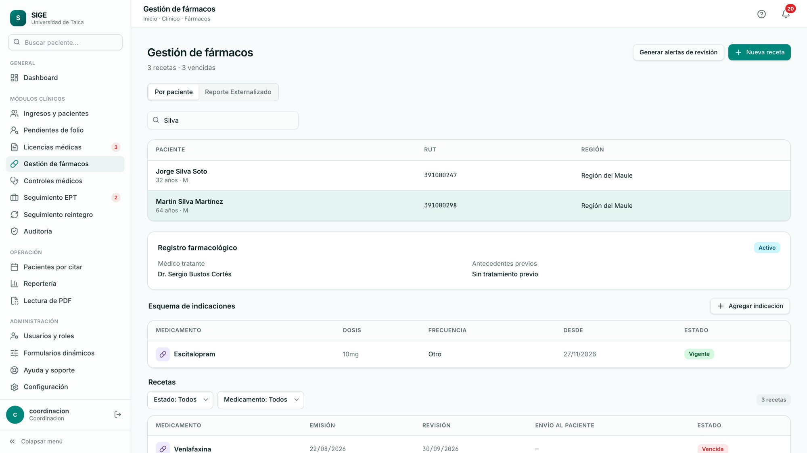

**Aprovechar lo recetado en SALUTEM**
1. Revisa el panel **«Fármacos recetados en SALUTEM»**.
2. Usa «Agregar al esquema» o «Registrar receta» en cada fármaco que corresponda. Ninguno se registra solo.

| Etiqueta | Significado |
|---|---|
| Vigente | La fecha de revisión aún no llega. |
| Por vencer | La revisión es dentro de los próximos 5 días. |
| Vencida | La fecha de revisión ya pasó. |
| Extra sistema | Fármaco indicado fuera del CEPA. |

---

## 8. Controles médicos

Aquí están los controles de cada paciente: fecha, próximo control, licencia, RECA y evaluación clínica.

**Cada atención médica realizada en SALUTEM crea su control sola**, con la fecha, el médico, la licencia, el reposo y el GAF. El estado RECA siempre lo completa el CEPA. Si ingresas a mano un control que ya vino de SALUTEM, queda duplicado.

**Registrar un control a mano**
1. Busca al paciente y selecciónalo.
2. Presiona **«Nuevo control»** y elige la fecha y el médico tratante, o «Otro» si no está en el catálogo.
3. Presiona **«Guardar control»**. La semana del tratamiento se calcula sola.

**Completar un control**
1. Usa los botones de la fila: «Próximo control», «Licencia/RECA» o «Evaluación».
2. Despliega la flecha junto a la fecha para ver el detalle clínico. Bajo la tabla están los «Documentos del paciente en SALUTEM».

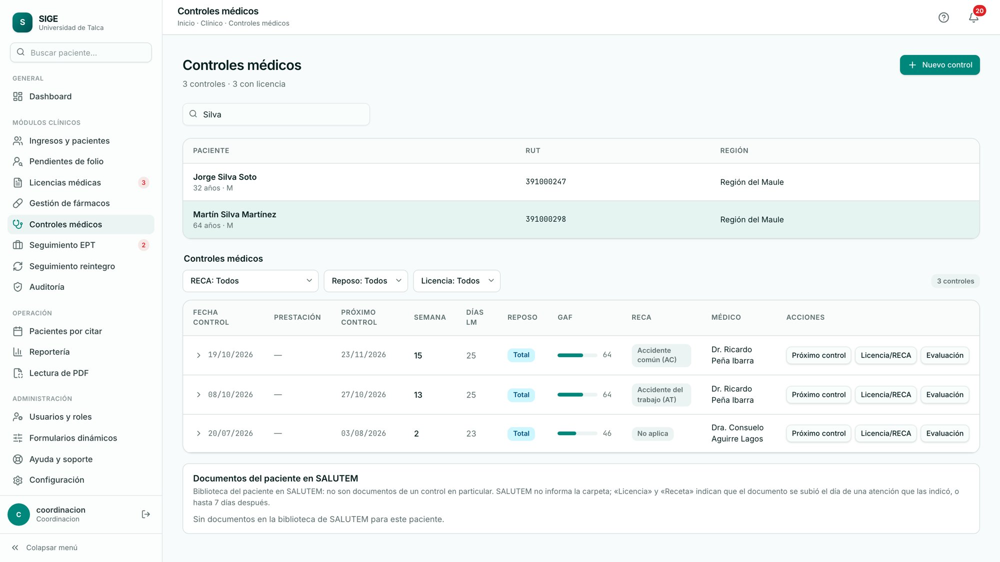

| Etiqueta | Significado |
|---|---|
| SALUTEM | Control creado solo, desde una atención médica en SALUTEM. No lo ingreses de nuevo. |
| Agendado | El próximo control ya tiene hora. |
| Fuera de ODA | La fecha no está cubierta por ninguna ODA del paciente. Llega la alerta «Cita fuera de la vigencia de la ODA». |

> Si «Ver» no abre un documento, permite las ventanas emergentes en el navegador.

---

## 9. Seguimiento EPT

Aquí se gestionan las Evaluaciones de Puesto de Trabajo: proceso, plazos y contactos con empleadores e ISL. **Solo el perfil Administrativo registra; Coordinación consulta.**

**Crear un caso EPT**
1. Busca al paciente por folio, RUT o nombre y selecciónalo. Aparece la lista de sus folios.
2. En un folio marcado «Sin EPT», presiona **«Nueva EPT»**. Cada folio admite una sola EPT.
3. Revisa los datos precargados (nombre, RUT, región y fecha de ingreso), completa EPTista y factor de riesgo, y guarda.
4. Después registra el «Proceso EPT» y los «Plazos EPT» desde el caso.

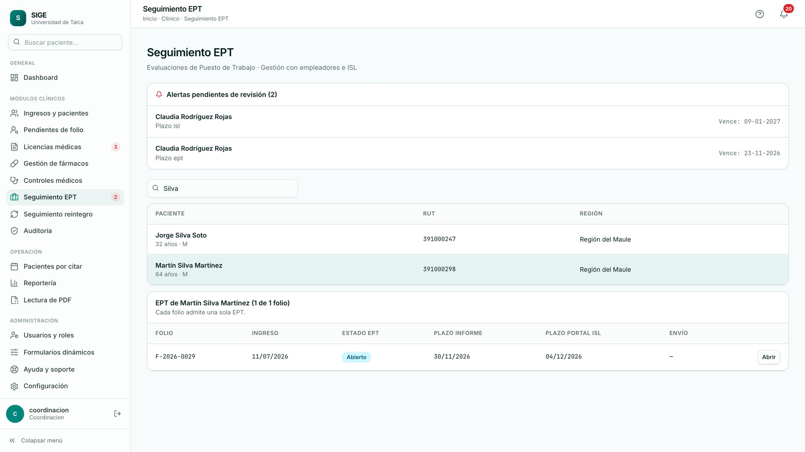

**Abrir una EPT existente:** busca al paciente y presiona «Abrir» en el folio, o entra desde su alerta.

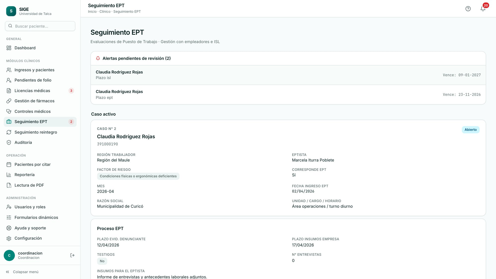

**Plazos EPT**
- El plazo del informe EPT es la fecha de ingreso más 15 días corridos. El del portal ISL es la fecha de ingreso más 19 días.
- Si ese día cae en sábado, domingo o feriado, el plazo se adelanta al día hábil anterior.
- Los plazos propuestos se pueden ajustar a mano antes de guardar.

Al guardar el caso, su proceso o sus plazos, se generan las alertas de insumos, informe EPT y portal ISL que correspondan. Además, se revisan cada mañana. Al registrar la fecha de envío, la alerta se resuelve.

| Etiqueta | Significado |
|---|---|
| En plazo | Aún hay tiempo. |
| Por vencer | El plazo está cerca. |
| Vencido | El plazo ya pasó. |
| Cumplido | Se entregó a tiempo. |

---

## 10. Seguimiento reintegro

Aquí se gestiona el reintegro laboral: caso, RECA, medidas correctivas y cierre con altas.

**Crear y cerrar un caso**
1. Busca al paciente, selecciónalo y presiona **«Nuevo caso»**.
2. Registra la RECA desde el panel **«RECA y medidas correctivas»**.
3. Al terminar, presiona **«Reintegro / cierre»**, indica el estado y las altas, y presiona **«Guardar cierre»**.

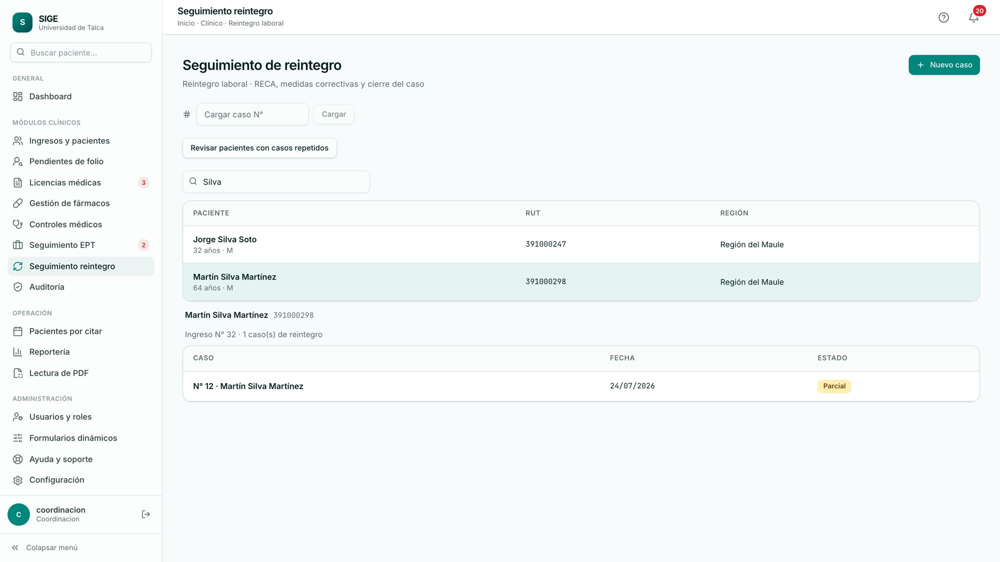

| Etiqueta | Significado |
|---|---|
| Pendiente | Aún no se reintegra. |
| Parcial | Reintegro parcial. |
| Total | Reintegro completo. |

> La fecha de reintegro no puede ser anterior a la fecha de la RECA ni a la del caso.

---

## 11. Pacientes por citar

Es la lista de trabajo de los pacientes que faltan por citar con cada profesional. Las horas se agendan en SALUTEM; aquí se organiza la lista y se registra el contacto.

**Trabajar la lista del día**
1. Elige el **«Profesional»** y el rango. Por defecto, «Dos semanas».
2. Parte por la sección **«Por citar»**: está ordenada por prioridad y muestra un día sugerido con cupo.
3. Llama al paciente y agenda la hora en SALUTEM.
4. Presiona **«Registrar contacto»** y elige el resultado: «Agendada en SALUTEM», «No contesta», «Rechaza» u «Otro».

**Cargar la disponibilidad de un profesional**
1. Abre **«Disponibilidad semanal»**.
2. Elige el día, indica el **«Cupo diario»** y presiona **«Guardar día»**.

Un paciente sale solo de la lista cuando SALUTEM tiene una hora vigente para él. Si registras «Agendada en SALUTEM», el paciente queda oculto 3 días hábiles mientras llega la hora.

| Etiqueta | Significado |
|---|---|
| Control vencido | La fecha del próximo control ya pasó. |
| Control próximo | El próximo control cae dentro del rango elegido. |
| Seguimiento receta | Una receta se revisa en los próximos 30 días. |
| En reposo hasta… | El paciente tiene una licencia que cubre los días con cupo. |
| Dijo agendada, sin hora en SALUTEM | Se registró «Agendada en SALUTEM» hace más de 3 días hábiles y SALUTEM sigue sin la hora. |

> Si todos los pacientes aparecen «Sin cupo», el profesional no tiene disponibilidad cargada.

---

## 12. Reportería

Aquí se generan los reportes operativos y de cumplimiento: operativo, convenio, carga laboral, licencias, ODAS vencidas, adherencia, ambulatorio y fármacos.

**Generar un reporte**
1. Elige la pestaña del reporte.
2. Completa los filtros marcados con *, por ejemplo «Desde» y «Hasta».
3. Presiona **«Generar»** o **«Consultar»**.

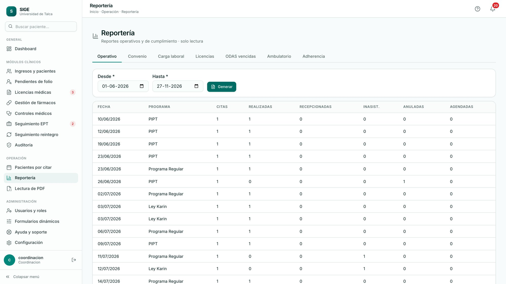

> En «Adherencia» se cuentan las citas atendidas sobre el total de atendidas más inasistencias. Las citas anuladas y las futuras no cuentan.

---

## 13. Auditoría

Muestra en una sola vista el caso completo de un paciente y entrega reportes para auditoría. Es solo de consulta. Tienen acceso Coordinación, Auditor y Superadmin, y los Administrativos con el permiso «Acceso a Auditoría».

**Revisar un caso**
1. En **«Vista de caso»**, elige buscar por RUT, folio o N° de siniestro y presiona **«Buscar»**.
2. Haz clic en el resultado para ver las evaluaciones, los controles y el cierre en una sola página.

**Descargar un reporte:** en **«Reportes»**, indica «Desde» y «Hasta», presiona **«Generar»** y luego **«CSV»**.

---

## 14. Lectura de PDF

Sube un PDF para detectar sus campos y revisarlos contra un formulario.

1. Presiona **«Subir PDF»**. El archivo puede pesar hasta 10 MB.
2. Revisa y corrige los **«Campos detectados»**. Puedes agregar o quitar campos.
3. Escribe el formulario destino y presiona **«Confirmar»**.

> Se detectan las líneas con formato «Clave: Valor». Si el PDF es una imagen escaneada, completa los campos a mano. «Confirmar» valida los campos, pero no registra datos en la ficha del paciente.

---

## 15. Configuración y administración

Estas pantallas son, en general, **solo de Coordinación**.

### 15.1 Usuarios y roles
1. Presiona **«Nuevo usuario»**.
2. Completa el usuario, el nombre, el rol y la contraseña (mínimo 8 caracteres).
3. Para quitarle el acceso a alguien, usa **«Desactivar»**. La cuenta no se borra.

### 15.2 Convenios
Los convenios se crean en SALUTEM. Para traer uno nuevo de inmediato, presiona **«Actualizar desde SALUTEM»**; si no, llega con la sincronización diaria. En el ingreso, el convenio se precarga con el «origen» del paciente en SALUTEM y se puede corregir.

### 15.3 Profesionales
- **«Importar desde SALUTEM»** trae los médicos nuevos.
- **«Nuevo profesional»** agrega a alguien a mano.
- **«Desactivar»** hace que alguien deje de aparecer en Pacientes por citar.
- Haz clic en un profesional para ver su actividad.

> Si cambias el nombre de un profesional que viene de SALUTEM, la próxima importación lo vuelve al nombre original.

### 15.4 Umbrales de alerta
1. Cambia los **«Días de anticipación»** de cada alerta, o marca si se cuentan en días hábiles.
2. Presiona **«Guardar umbrales»**. El cambio se aplica en la siguiente generación diaria de alertas, a las 07:00.
3. Para agregar un festivo, ve a **«Festivos»**, indica la fecha y la descripción, y presiona **«Agregar festivo»**. Los festivos también se descuentan en Pacientes por citar.

### 15.5 Formularios dinámicos
1. Escribe la clave del formulario y presiona **«Cargar»**.
2. Presiona **«Editar como nuevo borrador»** y ajusta los campos.
3. Presiona **«Guardar borrador»** y luego **«Publicar borrador»**. Los campos con candado son del sistema y no se pueden quitar.

### 15.6 Ventanas de proceso
1. Elige el **«Proceso»**.
2. Escribe las columnas visibles, separadas por coma, y si quieres el orden por defecto.
3. Presiona **«Crear»**.

---

## 16. Preguntas frecuentes

| Pregunta | Respuesta |
|---|---|
| Busco a un paciente y no aparece | Prueba con el RUT (con o sin puntos), con el folio exacto o con parte del apellido. Si se atendió en SALUTEM pero nunca tuvo ingreso, búscalo en «Pendientes de folio». |
| Registré algo en SALUTEM y no lo veo en SIGE | La copia desde SALUTEM se actualiza cada pocos minutos. Espera unos 5 minutos y recarga la página. Si después de una hora sigue sin aparecer, repórtalo. |
| ¿Tengo que ingresar a mano los controles de SALUTEM? | No. Las atenciones médicas de SALUTEM crean su control solas, con la etiqueta SALUTEM. Ingresar el mismo control a mano lo duplica. |
| ¿Por qué una licencia o receta de SALUTEM no quedó registrada? | Llegan como sugerencia, con una alerta. Una persona debe revisarlas y registrarlas; así se evitan errores de lectura. |
| Un paciente ya tiene hora, pero sigue en «Pacientes por citar» | Sale de la lista cuando la hora aparece en SALUTEM. Registra el contacto como «Agendada en SALUTEM» y quedará oculto 3 días hábiles mientras la hora se sincroniza. |
| ¿Dónde cierro un caso? | En la ficha del paciente, con «Cerrar caso». Un caso cerrado lo reabre Coordinación con «Reabrir caso». |
| ¿Qué significan los números rojos del menú? | Son pendientes. En Licencias y Seguimiento EPT, alertas sin resolver; en Pendientes de folio, pacientes que esperan su registro. |
| No veo un botón que otra persona sí ve | Cada perfil tiene permisos distintos (ver 1.1). Si necesitas otro perfil, pídelo a Coordinación. |
| ¿SIGE modifica datos en SALUTEM? | Nunca. La conexión es de solo lectura. |

---

## 17. Glosario

| Término | Definición |
|---|---|
| SALUTEM | Sistema de agenda y ficha clínica. SIGE lee sus atenciones, citas y personas, sin modificarlas. |
| ID SALUTEM | Identificador de la persona en SALUTEM. Sirve para buscar pacientes sin RUT. |
| Ingreso | Episodio de atención de un paciente en el CEPA. Un paciente puede tener varios (reingresos). |
| Folio | Identificador del ingreso, con formato F-2026-0001. Se asigna solo. |
| Folio LM | Número de la licencia médica. Es distinto del folio del ingreso. |
| ODA | Orden de atención asociada al ingreso, con fecha de vencimiento. |
| ISL | Instituto de Seguridad Laboral. Recibe las licencias y los informes EPT. |
| RECA | Calificación del origen: enfermedad profesional (EP), enfermedad común (EC), accidente del trabajo (AT) o accidente común (AC). |
| GAF / EEAG | Escala de funcionamiento global. Se registra por tramo, por ejemplo 51-60. |
| EPT | Evaluación de Puesto de Trabajo. |
| Extra sistema | Licencia o fármaco indicado fuera del CEPA. |
| Inasistencia | Cita de SALUTEM a la que el paciente no llegó. Genera una alerta. |
| Adherencia | Citas atendidas sobre el total de atendidas más inasistencias. |
| Encuadre | Estado del ingreso cuando el paciente deja de asistir. |
| Cupo diario | Pacientes que un profesional puede recibir cada día. Ordena la lista de Pacientes por citar. |
| Umbral | Días de anticipación con que se genera una alerta. |
